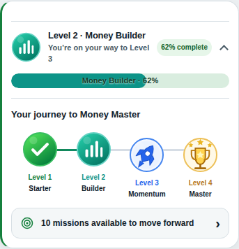
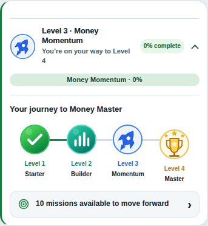
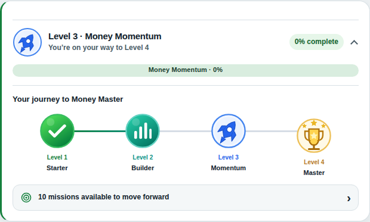

# Money Journey icon review

Source validated: `4a40bf2b88798d6cd67fb1227b7492e8578d495a`.

The completed-stage branch in `levelJourneyHTML` substituted `check` for the level icon. It now always passes `l.icon`. Completion remains represented by the stage class and accessible label.

Existing vector medallions are reused. The supplied mockup also exposed a left-facing white rocket and scattered trophy sparkles; the rocket now points upper-right with a blue body and the trophy has three stars above the cup. Green check and teal bars artwork are unchanged.

Validation: 53 unit tests and three Chromium browser tests passed in [GitHub Actions](https://github.com/RO2Studios/take-control/actions/runs/41497621606). Unit tests execute the actual production renderer for all 12 level/status combinations, including synthetic boundary states. Reintroducing the original substitution makes the completed Builder, Momentum and Master tests fail. Browser tests exercise every reachable current level at 375px, 390px and 1440px, verify icon selection/fit, no horizontal overflow, collapse persistence and unchanged saved fixture data/Today text after toggling and reloads. No page JavaScript errors were observed.

The screenshots below were visually inspected against Ralph's supplied four-phone mockup. Icon identity, color family, rocket direction and trophy stars were reviewed. These are vector interpretations of the reference; pixel-identical artwork is not established. Existing card dimensions, text wrapping, progress styling and Today layout differ from the full mockup and were deliberately outside this icon-only fix. Safari/iOS device rendering, offline upgrade behavior and an end-to-end celebration animation were not browser-tested in this change. CSS, progression, storage schema, celebration logic and navigation remain untouched.

Final visual approval is pending. The PR remains draft; nothing has been merged or deployed.

## Mobile, Level 2 (62%)

## Mobile, Builder completed

## Desktop, Builder completed

